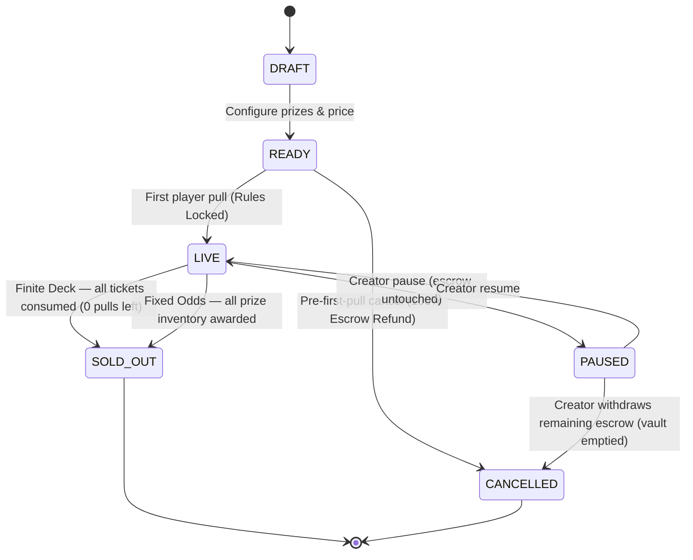

# RARE ARCADE — Economy & Mathematical Specification

## 1. Executive Summary
Rare Arcade is a creator-owned prize-machine marketplace played in **USDG
(Global Dollar)** on Robinhood Chain.

**USDG is the only play currency.** Every pull price, every cashback prize
credited back to a player, and every platform fee is denominated in USDG.
USDG is a Paxos-issued stablecoin redeemable 1:1 for US dollars, which gives the
platform a stable accounting currency and lets NFT USD top bids be used directly
as prize values with no price feed.

**$RAREFRIENDS (RF) survives as an optional cashback PRIZE currency.** Creators
may load a machine with USDG cashback, RF cashback, or both. RF is never
spendable on a pull. Because RF is volatile, each RF cashback prize captures an
immutable USDG value at seed time so a published machine's RTP can never drift
after the fact.

Every pull charges a fixed **5% platform fee**, split two ways:
- **75%** of the fee → treasury `0x927A1799125EAE57B6BDc573Ee5e0354cD343Db1`
- **25%** of the fee → **accrues in USDG into an RF buyback pot**, which is
  periodically swapped USDG → RF on an AMM and the RF sent to
  `0x000000000000000000000000000000000000dEaD` (burned).
- **95%** of the spend → machine creator/operator receipts.

The retired partner wallet `0x16B4297E0D804E711072Be361617D4E23C03c533` receives
nothing and is never routed to again.

**Stability property.** The buyback pot is denominated and accrued in USDG, and
only converts to RF when a batch executes — long after the pull that funded it.
Therefore: (a) a player is always charged 5% of their spend in USDG regardless of
the RF market, and (b) no published RTP depends on an RF price. RF volatility
affects only how much RF a given buyback acquires.

**Settlement is single-chain: Robinhood Chain only (chain ID 4663).** Only NFTs
on that chain can be funded into a machine. This keeps the contract surface to
one escrow vault, one fee router, and one VRF subscription, and it means every
prize NFT is verified by the same fresh on-chain `ownerOf` read — there is no
indexer-trust fallback. Enforced in `src/domain/settlement.ts` at both machine
constructors, so a cross-chain prize cannot reach a published machine.

In demo mode all deposits, escrow, fee routing, and payouts are simulated. **NFT
ownership is genuinely verified**: creators can only fund Rare Friends Genesis /
Generations NFTs their connected wallet holds (OpenSea discovery + fresh
on-chain `ownerOf` reads on Robinhood Chain, chain ID 4663).

---

## 2. Fundamental Units & Precision
To prevent JavaScript IEEE-754 floating-point drift:
- **Internal USDG Scale**: `1 USDG = 1,000,000 internal units`. This matches
  USDG's on-chain `decimals()` on Robinhood Chain exactly (verified via
  `eth_call decimals()` → `0x06`), so internal units map 1:1 to ERC-20 base
  units with no rounding at the contract boundary.
- **Internal RF Scale**: `1 RF = 1000 internal units` (`0.001 RF` resolution).
  RF is prize-only; see §3b.
- **Basis Points (BPS)**: `10000 BPS = 100.00%` (`1 BPS = 0.01%`).
- **Platform Fee BPS**: `500 BPS = 5.00%` (`PLATFORM_FEE_BPS = 500n`).
- **Creator Receipts BPS**: `9500 BPS = 95.00%` (`CREATOR_RECEIPTS_BPS = 9500n`).
- **Fee Routing**: `7500 BPS = 75%` of the fee to the treasury,
  `2500 BPS = 25%` of the fee to the RF buyback pot.

### Exact Pull Split Conservation Invariant
For any USDG pull price $P$:
$$\text{FeeUnits} = \left\lfloor \frac{P \times 500}{10000} \right\rfloor$$
$$\text{CreatorUnits} = P - \text{FeeUnits}$$
$$\text{PrimaryFeeUnits} = \left\lfloor \frac{\text{FeeUnits} \times 7500}{10000} \right\rfloor$$
$$\text{BuybackFeeUnits} = \text{FeeUnits} - \text{PrimaryFeeUnits}$$

$$\text{FeeUnits} + \text{CreatorUnits} \equiv P \quad (\forall P > 0)$$
$$\text{PrimaryFeeUnits} + \text{BuybackFeeUnits} \equiv \text{FeeUnits} \quad (\forall P > 0)$$

Integer-division remainder is always assigned to the buyback share, so the split
never creates or destroys dust — no value is lost or invented at split time. Both
invariants are asserted at runtime in `domain/fees.ts` and covered by tests.

### Buyback Batch Conservation
A batch spends the entire accrued pot on one swap and burns every RF acquired:
$$\text{UsdgSpent} \equiv \text{AccruedPot} \qquad \text{(no residue stranded)}$$
$$\text{RFBurned} = \left\lfloor \frac{\text{UsdgSpent} \times 1000}{\lfloor \text{Price} \times (1 + \text{slip}) \rfloor} \right\rfloor$$

Slippage is modelled as a markup on the effective price, so the RF burned is
**understated** rather than overstated — the safe direction for a published
figure. A batch that cannot execute (bad quote, pot too small for one RF) throws
and leaves the pot intact; a burn is never booked that did not happen.

---

## 3. Prize Valuation & Escrow Model
Machines support four classes of prize lines:
1. **USDG Cashback (`USDG_PRIZE`)**: paid straight back into the player's USDG
   balance. Valued at face. This is the default cashback option.
2. **RF Cashback (`RF_PRIZE`)**: paid in RF into a separate, non-spendable RF
   balance. Accounted in USDG via an immutable seed-time snapshot (§3b).
   Creators load these **in addition to** USDG cashback when they want to reward
   $RAREFRIENDS holders.
3. **NFT Prizes (`FRIEND_PRIZE`)**: AUTOMATIC top-bid value in USDG for a
   wallet-verified NFT actually held by the creator's connected wallet (any
   supported collection — Rare Friends Genesis/Generations remain pinned first).
    > *Top-bid reference for machine math — NOT a guaranteed market value. Rare
    > Arcade values NFT prizes automatically from the collection's top OpenSea bid;
    > creators never type an NFT's value during normal creation.*
4. **Try Again (No Prize)**: Reference value = $0.

### 3a. NFT Valuation Is 1:1 With USD
$$\text{usdgValueUnits} = \text{topBidUsd} \times 10^{6}$$

Because USDG is redeemable 1:1 for USD, the top bid **is** the prize's USDG
value — no division, no rounding error. This replaced the previous
`referenceRf = topBidUsd / rfUsd` conversion, which made a locked valuation drift
every time RF moved. See `src/nfts/valuation.ts`.

### 3b. RF Cashback Locks Its USDG Value at Seed Time
When a creator seeds an RF cashback prize, the RF amount is valued in USDG once,
using the RF/USDG rate available at that moment, and stored immutably:

$$\text{usdgValueUnits} = \left\lfloor \frac{\text{rfUnits} \times \text{priceUsdgPerRf}}{1000} \right\rfloor$$

The captured rate is kept as `rfPriceUsdg` for audit. A later oracle answer can
never revalue a published machine. In live mode this rate comes from
`web3/contracts.ts → rfPriceOracle`.

### Total Reference Prize Value ($V$)
Every line is valued in USDG regardless of payout currency:
$$V = \sum_{i} \left( \text{quantity}_i \times \text{usdgValue}_i \right)$$

### Seeding Escrow
Upon publishing, two separate escrows are taken — the currencies never merge or
substitute for one another:
- USDG cashback comes out of the creator's **USDG** balance.
- RF cashback comes out of the creator's **RF** reserve.
- Seeded Rare Friends move from Creator's Owned inventory into Machine Escrow.

Cancelling a machine before its first pull refunds both escrows in their
original currencies, plus every seeded NFT.

Once a machine has started selling, escrow that is never won can instead be
returned in full via the machine vault — see §7b.

---

## 4. Expected Value (EV) & Return to Player (RTP)

### Initial EV per Pull
$$\text{EV}_{\text{initial}} = \frac{V}{\text{TotalPulls}}$$

### Player RTP (in BPS)
$$\text{RTP}_{\text{BPS}} = \left\lfloor \frac{\text{EV}_{\text{initial}} \times 10000}{P} \right\rfloor$$

### Modeled Operator Margin
$$\text{OperatorMargin}_{\text{BPS}} = 9500 - \text{RTP}_{\text{BPS}}$$
- Example 1: At $90\%$ RTP, Operator Margin $= 95\% - 90\% = 5\%$.
- Example 2: At $95\%$ RTP, Operator Margin $= 95\% - 95\% = 0\%$.
- Example 3: At $110\%$ RTP (creator-subsidized), Operator Margin $= 95\% - 110\% = -15\%$.

## 4b. Custom RTP (presets are suggestions, not restrictions)
Quick picks `80% / 85% / 90% / 95%` remain; CUSTOM accepts any positive finite
percentage with decimals (e.g. `72.5%`, `107.5%`, `125%`), stored exactly as
integer basis points (`72.5% = 7250 bps`). Only a generous technical cap
(`100000 bps = 1000%`) guards pathological input.
- **RTP > 95%** → PLAYER-FAVORABLE ECONOMICS warning (prize value exceeds
  post-fee receipts). Allowed.
- **RTP > 100%** → CREATOR-SUBSIDIZED MACHINE label with negative margin. Valid
  for promotions/giveaways. Allowed.
- **Very low RTP (< 50%)** → unmistakable preview; players see it publicly. Allowed.
- Target vs Actual RTP are both shown (integer tickets make them differ slightly).

---

## 5. Target RTP Solver & Recommended Ticket Count
When a creator chooses a pull price $P$, target RTP $R_{\text{target}}$ (default $90\%$), and seeds prizes with total value $V$:
$$\text{TargetEV} = \frac{P \times R_{\text{target}}}{10000}$$
$$\text{RecommendedPulls} = \max\left(\text{TotalPrizeItemCount}, \left\lfloor \frac{V + \frac{\text{TargetEV}}{2}}{\text{TargetEV}} \right\rfloor \right)$$

Because ticket counts are discrete integers:
- The UI exposes both **Target RTP** and **Actual Initial RTP**.
- No product RTP guardrails: any positive finite RTP is publishable (V1's
  75–95% restriction removed; `MIN/MAX_ALLOWED_RTP_BPS` deprecated, unenforced).

## 5b. Demo RF Scale (low-unit-value token calibration)
`src/domain/demoEconomy.ts` centralizes all demo suggestions (math unchanged):
- Pull-price picks: `1,000 / 2,500 / 5,000 / 10,000 RF` (default `2,500`).
- RF-prize picks: `5,000 / 10,000 / 25,000 / 50,000 / 100,000 RF` + custom.
- Player start: `250,000 RF` (simulated). Creator start: `2,500,000 RF` (simulated).
- Seeded fixtures: RF RAIN (1,000/pull × 100, 90.0%), FRIEND FRENZY (5,000/pull
  × 100 with real Generations #8283 @ 250,000 RF ref, 90.0%), HIGH ROLLER
  (10,000/pull × 30 with real Genesis #773 @ 150,000 RF ref, 90.0%).
- Display: thousands-grouped exact values (`2,500,000.00 RF`); compact
  (`2.5K/250K/2.5M RF`) only where space is tight, exact on details.

---

## 6. Dynamic Finite Inventory & Current RTP
Friend Machines have finite supply (e.g. 50 pulls). Each pull removes exactly one ticket from the shuffled deck.
At any point with $N_{\text{rem}}$ tickets remaining and $V_{\text{rem}}$ prize value remaining:
$$\text{EV}_{\text{current}} = \frac{V_{\text{rem}}}{N_{\text{rem}}}$$
$$\text{RTP}_{\text{current}} = \left\lfloor \frac{\text{EV}_{\text{current}} \times 10000}{P} \right\rfloor$$

> **Compelling Dynamic**: If high-tier prizes survive into the late stages of a machine, $\text{RTP}_{\text{current}}$ can rise significantly above $100\%$, creating natural player interest without deceptive odds.

---

## 7. Machine Lifecycle & State Invariants

### Immutable Rules Lock
- Before the first pull (`pullCount === 0`), a creator can cancel the machine. All seeded RF escrow and Rare Friends are returned immediately.
- Upon the **very first pull**, `isRulesLocked` becomes `true`.
- The creator cannot alter:
  - Pull price
  - Total ticket count
  - Prize inventory
  - Platform fee rate (fixed at 5%) or its 75/25 routing
- Sold-out machines reject any further pulls.

---

## 7b. The Machine Vault — Pause & Creator Escrow Withdrawal

Once a machine starts selling, its prize escrow can sit there long after the
last prize is worth pulling for. The vault is how a creator gets that unused
escrow back without ever rewriting the rules they published. Implemented in
`src/domain/vault.ts`.

### Vault Contents
The **vault** is whatever prize escrow is still locked in the machine, computed
**only** from `remainingPrizes × remainingQuantity`:

$$\text{Vault} = \sum_{i:\,\text{remaining}_i > 0} \text{remaining}_i \times \text{usdgValue}_i$$

`initialPrizes` is the published snapshot and is **never** read for a refund.
This is the invariant that makes double-payment impossible: a prize already won
by a player is not in `remainingPrizes`, so it can never be refunded. Per line,
`initialQuantity = remainingQuantity + withdrawnQuantity + paidOut`, so the split
is auditable after the fact.

### Pause — Freezing, Not Unwinding
- Sets `status = PAUSED`. Pulls are rejected by both pull engines.
- Touches **no** escrow: USDG, RF, and NFT balances are bit-for-bit identical
  before and after.
- Fully reversible. Resuming clears `pausedAt` and returns the machine to
  `LIVE` with identical contents.
- Costless and permissionless for the creator — it is a hold, not a penalty.

### Withdrawal — All-or-Nothing, Terminal
- **Requires a prior pause.** Winding a live machine down is a two-step,
  deliberate action.
- **Full or nothing.** There is no partial withdrawal. Partial withdrawal would
  change live RTP and odds mid-game, which the rules-lock promise forbids.
- Returns the **entire** remaining vault to the creator in its original
  currencies — USDG to the USDG balance, RF to the RF reserve, Rare Friends to
  the creator's inventory — then closes the machine (`status = CANCELLED`,
  `remainingPulls = 0`, deck dropped for Finite Deck).
- Zeroes every `remainingQuantity` and records the amount in
  `withdrawnQuantity`, so no later pull could award an asset that has left.
- Emits one `ESCROW_WITHDRAWN` ledger event per currency and per NFT, plus a
  closing `MACHINE_CANCELLED` event explaining the wind-down.

### What Withdrawal Deliberately Does *Not* Do
| Preserved | Why |
|---|---|
| `isRulesLocked` stays `true` | The published odds are a promise; a wind-down must not retroactively unlock them. |
| `initialPrizes` untouched | The published RTP/EV record is immutable history. |
| `initialRtpBps` / `currentRtpBps` untouched | They describe the game as played. There is no live vault left to price, and zeroing them would destroy the record. |
| Prizes already won | Players keep everything they won. Withdrawal returns *unused* escrow only. |
| Platform fee totals & the buyback pot | Those are fee revenue, not prize escrow, and are pooled platform-wide. The vault has no path into the RF buyback pot. |

### Relationship to Pre-First-Pull Cancel
| | Cancel (§3) | Vault withdrawal (§7b) |
|---|---|---|
| Requires `pullCount === 0` | Yes | No — works mid-life |
| Requires `isRulesLocked === false` | Yes | No |
| Refund computed from | `initialPrizes × initialQuantity` | `remainingPrizes × remainingQuantity` |
| Refunds the full original seed | Yes | No — only what is left |
| Leaves the machine playable | No | No |

On a machine with no pulls taken, the two paths refund **identical** amounts —
asserted in `src/domain/__tests__/vault.test.ts` so the vault can never quietly
become a way to mint escrow.

### Authorization
Only the machine's operator may act, where operator = the creator id that funded
the machine plus any connected wallet matching it (`isVaultOperator`). Players
have no standing in a machine's escrow. Authorization is enforced in the domain
layer, not only by hiding buttons — an unauthorized call throws.

### Disclosure
The vault breakdown is **public** on every machine detail page, not just to the
operator: players are owed transparency about what is still sitting behind the
pull button. Only the controls are gated. A paused machine shows `PAUSED` and its
pause date on the arcade floor card and never advertises a pull price.

### Withdrawal frees the NFT
A withdrawn Rare Friend stops counting as reserved
(`collectReservedNftKeys`), so it can immediately be funded into another
machine. Only `remainingPrizes` carries `withdrawnQuantity`, so the published
`initialPrizes` snapshot alone would otherwise keep the returned token booked.

---

## 8. Verifiable Randomness & Deck Construction
- The finite ticket deck contains exactly $\text{TotalPulls}$ tickets.
- Web Crypto API (`crypto.getRandomValues`) powers the Fisher-Yates shuffle during production/demo execution.
- Deterministic seeded PRNG (Mulberry32) is provided for automated invariant test suites.
- Odds are transparently displayed and recalculate live after each pull:
  $$\text{Probability}_i = \frac{\text{RemainingQuantity}_i}{N_{\text{rem}}}$$
  The sum of all displayed probabilities is guaranteed to equal $100.00\%$.

---

## 9. Fixed Odds Model

A Fixed Odds machine has **no ticket deck and no play cap**. Each pull rolls
fresh independent randomness against immutable per-prize probabilities.

### Probability precision
Probabilities are stored as integer **parts-per-million** (`1,000,000` = 100%),
supporting granularity down to `0.001%` with zero binary float drift.

### Fixed Odds probability
For prize slot $i$ with configured width $w_i$ ppm, every pull resolves:
$$\text{P(award } i) = \frac{w_i}{1{,}000{,}000}\quad\text{(while quantity remains)}$$

### No-prize odds
$$\text{NoPrize}_{\text{base}} = 1{,}000{,}000 - \sum_i w_i$$
$$\text{NoPrize}_{\text{effective}} = \text{NoPrize}_{\text{base}} + \sum_{\text{sold-out }j} w_j$$

### Sold-out slot behavior
When a prize's quantity reaches zero, its configured $w_i$ is **retained** and
rolls landing in its interval become empty outcomes. Other prizes' odds never
change; intervals are never rebuilt.

### Sellout condition
$$\text{SOLD\_OUT} \iff \text{all RF + Friend remaining quantities} = 0$$

### Configured RTP (never changes)
$$\text{EV}_{\text{configured}} = \frac{\sum_i \text{refVal}_i \times w_i}{1{,}000{,}000}$$
$$\text{RTP}_{\text{configured}} = \left\lfloor \frac{\text{EV}_{\text{configured}} \times 10000}{P} \right\rfloor$$

### Live Available RTP (inventory depletion, not rebalancing)
Same formula restricted to prizes with remaining quantity $> 0$. Decreases as
prizes sell out.

### Creator post-fee edge
$$\text{Edge} = 95\% - \text{RTP}_{\text{configured}}$$
(negative = creator-subsidized/promotional machine).

### Realized payout ratio (at completion only — never "RTP mid-run")
$$\text{Realized} = \frac{\text{USDG reference value actually distributed}}{\text{total USDG spent}}$$
Varies with luck: the pull count required to exhaust inventory is random.

### Lifetime modeling
Seeded Monte Carlo over independent-pull lifetimes estimates median/P25/P75
pulls to sellout, median volume/fee/receipts/net, early-sellout (p10 net)
and long-tail (p90 pulls) scenarios. Labeled MODELED/SIMULATED ESTIMATE —
never a guarantee.

---

## 10. Fundamental Fixed Odds Disclosure

It is impossible to have all three of:

1. finite prize inventory
2. individual prize odds that never change
3. constant live RTP after prizes sell out

without either changing remaining prize odds, replenishing inventory, or
replacing exhausted outcomes with something of equal value.

Rare Arcade chooses **FIXED INDIVIDUAL ODDS**: sold-out prize probability
becomes an empty result. This preserves the core promise honestly.

---

## 11. Future: Optional Restock Model (deferred)

Creators could keep a Fixed Odds machine running indefinitely by adding
inventory to an EXISTING prize slot at the SAME configured odds (RF only;
NFT slots stay unique-token). Restocking must never change probabilities.
Not implemented in this pass — documented here as the designed future path.

---

## 12. NFT Valuation Pipeline (automatic top-bid model)

**Market data source:** OpenSea API v2 (read-only, client-side).

- Wallet inventory: `GET /api/v2/chain/{chain}/account/{address}/nfts`
  across a controlled chain registry (discovered via `GET /api/v2/chains`,
  priority chains first, concurrency ≤ 4, paginated, 45s cache).
- Ordinary NFT USD reference: the **collection's top bid in USD** — the max
  ACTIVE offer from `GET /api/v2/offers/collection/{slug}` (client-side max;
  endpoint is unsorted, up to 3 pages scanned; 3min cache, deduped per slug).
  Offer totals are divided by the NFT consideration quantity first: bulk bids
  (live: $0.50 for 25 Generations, $3,080 for 2 Genesis) convert to per-item
  bids ($0.02, $1,540) so order totals can never inflate a single NFT's
  reference.
  `estimated_value_usd` is informational only — never economics.
- **Rare Friends Genesis:** the collection top bid as the USD reference.
- **Rare Friends Generations (special case):** the top ACTIVE bid targeting
  the NFT's actual `Generation` trait (live
  trait_type `"Generation"`, values `"0"`–`"6"`) via
  `GET /api/v2/offers/collection/{slug}/traits?mode=NUMERIC&type=&min_value=&max_value=`
  (max ACTIVE, 3min cache, deduped per generation). Bid prices convert to USD
  via the payment-token price
  (`GET /api/v2/chain/{chain}/payment_token/{address}`); USD-pegged symbols
  (USDG/USDC/USDT/DAI/USD) convert 1:1. If no generation bid exists, the
  overall collection top bid (max ACTIVE non-trait offer from
  `GET /api/v2/offers/collection/{slug}`, up to 3 pages — endpoint is
  unsorted) applies and is labeled `COLLECTION BID FALLBACK`. If no bids
  exist the NFT is `UNPRICED`.
- **$RAREFRIENDS price:** `GET /api/v2/chain/robinhood/token/0x0779369854d3ecdea927206718ffd7730c67b71f`
  (`usd_price`), verified by exact chain + contract (never symbol-only),
  fetched once per refresh period (45s cache).

**Conversion (precise decimal math, no binary float):**

$$\text{referenceRf} = \frac{\text{topBidUsd}}{\text{rfUsd}}$$

USD strings scale to integer microunits (1e9); the division rounds to the
nearest 0.001 RF (1 internal unit, `1 RF = 1000 units`).

**Ordering:** Rare Friends pinned first (internally by RF reference DESC);
other collections by top-bid USD DESC (ties A–Z); unpriced last. Within a
collection: RF reference DESC, then token ID/name.

**Snapshot locking:** immediately before publish, ownership + bids + RF
price refresh; each NFT prize stores an immutable `valuationSnapshot`
(method, source `opensea`, collectionSlug, traitType/Value, topBidUsd,
bidNative/Currency, rfUsd, referenceRf, valuedAt, fallbackUsed). Published
`referenceValueUnits` never refloat — live market moves cannot mutate
configured RTP/EV. Legacy pre-automation machines carry
`legacy_manual` snapshots with their original locked values; seeded demos
carry labeled `demo_snapshot` fixtures.

**Finite Deck + Fixed Odds:** both consume the same locked
`referenceValueUnits` (deck EV/RTP solver vs configured/live-available RTP,
creator edge, Monte Carlo lifetimes). RF prizes are unaffected (direct RF).
Unpriced NFTs are shown but block publication (never valued at zero).

---

## 13. Pull FX Presentation Rules (visual only — no economics)

The pull animation is **presentation only**. The authoritative result is
determined by RNG **before** the animation starts; reels, tiles, capsules,
parcels, and claws only render an already-known outcome. Nothing in this
section may influence odds, RTP, deck construction, or settlement.

**Shell identity (no nested secondary machines):**

| Shell | Ritual |
|---|---|
| CLASSIC | PRIZE DRUM (tiles tumble, mystery tile exits) |
| CAPSULE | capsule ball only: settle → shake → pause → shake → open |
| TALLBOY | rail + claw + parcel + delivery only |
| MINI | three-reel assembly only |

**Reveal ordering (mechanics first, shine second):**
`MACHINE_ACTION → MACHINE_COMPLETE → REVEAL_HOLD → PRIZE APPEARS → SHINE BURST`.
Shine never appears while a capsule is shaking, the drum is spinning, the
claw is travelling, or the reels are turning.

**No-prize is visually quiet:** no shine burst, no celebratory pixels. The
shine only fires for `resultKind` of `rf` or `nft`, which keeps it
meaningful. `resultKind` is a broad visual hint derived from the settled
`prizeType` via `resultKindForPrizeType`; it never feeds back into RNG.

**MINI reel geometry (arithmetic, not eyeballed):** stage width 128;
chassis `x=10, width=108`; reels `x = 16, 50, 84` (pitch 34); reel
`28x40` with a 3px ink frame and a `22x34` warm-paper interior; symbol is
a 5x5 bitmap at `pixel=2` (10x10) at offset `x+9, y+15`, i.e. exactly 9px
of horizontal and 15px of vertical padding on every reel. Gutter is 6px
and outer margins are 6px each side, so the assembly reads as one
mechanical object. `MINI_REEL_GEOMETRY` is the single source of truth.
Reel motion is a deliberately stepped vertical scroll (80ms/frame, 4px
quantum) with the outgoing symbol travelling up while the next enters from
below, both clipped to the reel window — never an in-place symbol swap.
Stops are sequential at 1650 / 1950 / 2250ms.

**Reveal shine (three tones, one implementation):** the sparkle is built
from `PixelShine` in `PixelShine.tsx`, shared by the SVG pull stages and
the HTML prize panel so there is exactly one shine system:

1. mid-gray depth (`#8C8B84`) — defines the physical edge
2. light-gray rays (`#C7C6BE`) — reflected light
3. pure-white hotspot (`#FFFFFF`) — the hottest point only

Pure white is never the silhouette, which is why the star stays readable
on black, warm off-white, gray, and NFT frame backgrounds instead of
looking like erased pixels. Frames run tiny glint → medium → full shine →
medium over ~520ms. Glint anchors are fixed (never randomized) and sit
outside the prize's footprint so a burst never covers the coin, the RF
amount, or NFT artwork. Exactly 2–3 glints are used; there is no particle
explosion.

**Pure-white discipline:** large static surfaces use paper `#F3F1E8`,
light gray, mid gray, or black. Pure white is reserved for small specular
highlights, sparkle centers, and tiny reflections. All shine geometry is
emitted on whole logical pixels — no subpixel values.

---

## 14. Cashback Coin Material (canonical pixel artwork)

The cashback coin is defined in exactly ONE place:
`src/components/ui/RfTokenIcon.tsx`. Top Chase, USDG and RF cashback
prizes, the player and creator balances, the platform-fee routing visual,
and the prize reveal all render that same component, so the coin is
identical everywhere and there is no second or size-specific token asset.

The 5% fee's visual shows two streams: one settling at the treasury, one
travelling onward to be swapped into RF and burned (`PlatformFeeVisual.tsx` +
`.fee-route-treasury` / `.fee-route-buyback` in `arcade.css`).

**Material: deliberately FLAT.** The coin carries NO surface shine — no
specular highlights, no reflection blocks, no white hotspots, no grey
shading. A previous pass added layered mid-grey / light-grey / white
reflections to give the coin depth; in practice the extra blocks read
as clutter on a coin this small, and at 20-24px they degraded into
noise beside the balance numbers. Depth comes from STRUCTURE alone:

| Layer | Token | Purpose |
|---|---|---|
| rear extrusion | `deep` `#66665F` | the coin's thickness |
| outer stepped silhouette | `ink` `#090909` | outer edge |
| outer face | `paper` `#F3F1E8` | rim band |
| inner rim | `ink` `#090909` | recessed frame |
| central face | `paper` `#F3F1E8` | field the `$RF` sits on |
| `$RF` bitmap | `ink` `#090909` | lettering, drawn last |

That is a clean, high-contrast monochrome pixel coin that stays legible
at 20px and still reads as a collectible object at 144px.

**No shine on the token, anywhere.** This covers the reveal too. An
earlier pass overlaid three mid-grey / light-grey / white glint marks
around the `$RF` coin on the prize-reveal panel. They sat directly
against the coin's stepped silhouette and warm off-white face, so the
token read as speckled rather than collectible, and the marks looked
like dirt on the artwork. The `$RF` reveal therefore presents the coin
clean: no glints, no overlay, just the coin rising, bouncing, and the
amount appearing. `PixelShine` remains in use for NFT reveals and the
SVG pull stages only — never for `$RF`.

**Hard rules (enforced by tests).**

- No `#FFFFFF`, `#C7C6BE`, or `#8C8B84` may appear in the token. Those
  three tones belong to the pull-FX shine system only.
- The `$RF` lettering is the ONLY rect content: exactly 49 lit 2x2 ink
  pixels at every size, and every one of them must sit on the central
  face so nothing can chip or erase the rim.
- The five structural paths and their geometry are fixed; only whole
  logical pixels, no gradients, filters, blur, or drop-shadows.
- Output is byte-identical across every size apart from `width`/`height`
  — there is no size-specific variant.

**Palette.** Fills come from the shared
`src/components/ui/pixelPalette.ts` (`PIXEL`), so the token cannot drift
from the pull-FX pixel art and no raw hex literals live in the
component. This is intentionally the warm pixel ramp, not the cooler CSS
UI palette (`--color-black`, `--color-gray-*`).

---

## 16. Demo → Live: the contract surface this math must reproduce

Everything in `src/domain/**` is pure, deterministic math. **That math is the
specification the on-chain contracts must reproduce exactly.** Going live does not
change the economics — it changes who executes them and where funds sit.

`src/web3/contracts.ts` holds the registry. `RARE_ARCADE_MODE` is the runtime
switch, and it is `'demo'` until every address below is filled in.

| Role | Status | Address |
| --- | --- | --- |
| `usdg` | **deployed, verified** | `0x5fc5360d0400a0fd4f2af552add042d716f1d168` |
| `arcadeVault` | TODO | `0xTODO` |
| `machineRegistry` | TODO | `0xTODO` |
| `prizePool` | TODO | `0xTODO` |
| `feeRouter` | TODO | `0xTODO` |
| `vrfCoordinator` | TODO | `0xTODO` |
| `rfCashback` | TODO (optional) | `0xTODO` |
| `rfPriceOracle` | TODO (optional) | `0xTODO` |

Settlement: Robinhood Chain, chain id **4663**, RPC
`https://rpc.mainnet.chain.robinhood.com`.

### Contract obligations

- **`feeRouter`** must expose `PLATFORM_FEE_BPS() == 500`,
  `primaryRecipient() == 0x927A1799125EAE57B6BDc573Ee5e0354cD343Db1`, and
  `burnSink() == 0x000000000000000000000000000000000000dEaD`. The 25% share must
  be **accrued into a buyback pot and swapped to RF**, never forwarded to a
  treasury wallet. Its `splitFee(spend)` must match `calculatePullSplit(spend)`
  exactly, including integer rounding — that equality is the single most
  important integration test before mainnet.
- **`feeRouter.executeBuyback()`** swaps the pot USDG → RF on an RHC AMM and
  sends the RF to `burnSink()`. Needs a swap router, a price bound, and access
  control (a keeper or permissionless trigger). Batching, not per-pull.
- **`arcadeVault`** holds player USDG between pulls and creator USDG cashback
  while it is escrowed. A pull may only spend escrow the player actually funded.
- **`prizePool`** escrows all three prize classes. `fundRfPrize` takes the
  seed-time USDG value as an argument so a later oracle answer cannot revalue a
  published machine.
- **`machineRegistry`** stores pull price, locked rules, deck seed or fixed-odds
  table, and prize config. Rules lock on the first pull and never change after.
- **`vrfCoordinator`** replaces the in-browser RNG. Strongly recommended before
  mainnet — without it, a player can predict or replay outcomes client-side.

### Operator checklist before flipping `RARE_ARCADE_MODE` to `'live'`

1. Paste all required addresses into `src/web3/contracts.ts`.
2. Confirm `liveReadinessReport().liveReady === true` (surfaced in the app under
   **CONTRACTS** in the header banner).
3. Assert on-chain that `feeRouter` fee bps and both recipients match §2.
4. Run an integration test asserting `feeRouter.splitFee(spend)` equals
   `calculatePullSplit(spend)` across a spread of spend amounts, including
   values that trigger integer rounding.
5. Wire a real signing path. `src/web3/usdgClient.ts` intentionally implements
   reads only — `approve()` and `transfer()` throw until a deployed vault exists
   to approve, so the app cannot appear to move funds it cannot actually move.
6. Switch randomness to VRF.

### Storage migration note (v4 → v5)

The v4 → v5 migration **preserves** display settings, the connected wallet, and
any real owned Rare Friends NFTs. It **re-seeds** machines, balances, and the
ledger, because translating RF-denominated machines into USDG would require
picking an RF price and would silently rewrite every published RTP. RF cashback
prize value is locked per-prize instead, so nothing needs retro-fitting later.
